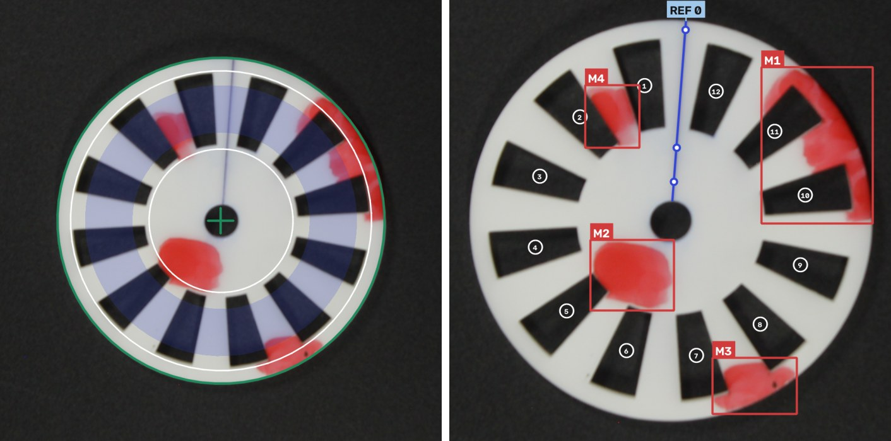
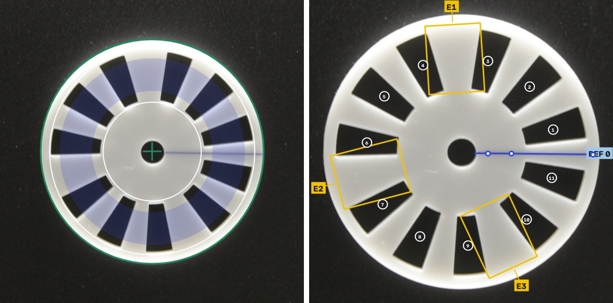

# Optical encoder disc diagnosis (v1.4)

[English](#english) · [Español](#español)

<p align="center">
  
  
</p>

---

<a id="english"></a>

## English

The system diagnoses an encoder disc from a single photo. It locates the disc, checks image quality, counts the slots, finds the blue reference mark and detects missing sectors, wrong widths, added sectors and red stains. It implements the specification `solucion_diagnostico_encoder_v1.4.md`. Code, interface and data files are in Spanish.

### Detection examples

Each example shows the disc located in the original photo (left) and the rectified disc with its defects (right). Slots are numbered 1 to N counter-clockwise from the reference line (REF 0). Labels are S# for missing sectors, E# for wrong widths (yellow) and M# for stains (red).

| Photo | Result |
|---|---|
| `ejemplos/Luz directa/Manchas/IMG_0830.JPG` | Defective. Correct geometry (A0), four stains M1 to M4 (B1) |
| `ejemplos/Campo oscuro/Normales/IMG_0951.JPG` | Defective. Three bars of incorrect width E1 to E3 (A2), no stains (B0) |

### Installation

Requires Python 3.10 or later.

```bash
pip install -r requirements.txt
```

Tested with Python 3.13, OpenCV 5.0 and Gradio 6.29; Gradio 5 is also supported.

### Usage

```bash
python app_diagnostico.py         # diagnosis app, http://127.0.0.1:7860
python app_generador_ruido.py     # noise generator, http://127.0.0.1:7861
```

Upload a JPG or PNG photo and press Diagnosticar. Results appear stage by stage; if validation fails, the process stops and reports the reason. The app lists one example per condition from `ejemplos/`. To use another photo set, set `ENCODER_FOTOS` to a folder whose subfolders are the capture conditions:

```bash
ENCODER_FOTOS=/path/to/photos python app_diagnostico.py
```

In PowerShell: `$env:ENCODER_FOTOS = "C:\path\to\photos"`.

### Example photos

`ejemplos/` contains one photo per capture condition, without EXIF metadata.

| Folder | Condition |
|---|---|
| `Luz difusa` | Diffuse light |
| `Luz directa/Normales`, `Luz directa/Manchas` | Direct light, clean or stained disc |
| `Campo oscuro/Normales`, `Campo oscuro/Manchadas` | Dark field, clean or stained disc |
| `Desenfocadas` | Out of focus (expected rejection) |
| `Inclinación/Normal`, `Inclinación/Manchas`, `Inclinación/Menos 30` | Tilted disc, about 40° and under 30° |
| `Largo` | Long distance |
| `Mala iluminación/Luz directa`, `…/Mucho brillo`, `…/Oscuras` | Harsh light, overexposure, underexposure |
| `Fondo con textura` | Textured background |
| `Ruido añadido` | Synthetic Gaussian noise, σ ≈ 36 |
| `Casos de error` | Expected failure cases |

### Structure

```
encoder_diag_entrega/
├── app_diagnostico.py          # diagnosis app (port 7860)
├── app_generador_ruido.py      # noise generator (port 7861)
├── calibrar.py                 # batch measurement and threshold rules
├── requirements.txt
├── docs/                       # README figures
├── ejemplos/                   # example photos, one per condition
├── subfunciones/               # blocks 1 to 7 and utilities
│   ├── config.py
│   ├── adquisicion.py … clasificacion.py
│   ├── escala.py, pipeline.py, visualizacion.py
│   └── estilo_interfaz.py      # CSS shared by both apps
└── datos/
    ├── calibracion.json        # calibrated thresholds and their rules
    ├── referencia_escala.jpg / .json
    └── salidas_calibracion/    # labels, measurements, results, noise sweep, plots
```

Run the apps and `calibrar.py` from the project root. Paths are relative to the project folder (`subfunciones/config.py`).

| File | Block | Function |
|---|---|---|
| `config.py` | | Parameters and paths; loads `datos/calibracion.json` on import |
| `adquisicion.py` | 1 | JPG or PNG photo → `I0` and `I_loc` (1600 px) |
| `segmentacion.py` | 2 | V channel, Otsu + η, morphology, most circular contour, `fitEllipse` |
| `normalizacion.py` | 3 | Affine ellipse → circle, DN = 1000 px, 1100 × 1100 crop |
| `ruido.py` | 4 | Immerkaer σ̂ and self-tuned bilateral filter (Gaussian as alternative) |
| `validacion.py` | 5 | Quality criteria: value, threshold, level, pass/fail |
| `caracteristicas.py` | 6 | Polar image, mark, profile p(θ), DFT, blue blocks, stains |
| `clasificacion.py` | 7 | Axes A/B and verdict |
| `escala.py` | | Reference scale and apparent diameter |
| `pipeline.py` | | `ejecutar()` (staged generator), `analizar()`, `medir()` |
| `visualizacion.py` | | Annotated images, plots, tables |
| `estilo_interfaz.py` | | CSS and Gradio version |

### Calibration

```bash
python calibrar.py todo --fotos <photo_folder>             # labels, measure, thresholds, review
python calibrar.py ruido --zip ruido_diseno_YYYYMMDD.zip   # K_BILATERAL sweep
python calibrar.py color                                   # optional: colour samples (cv2.selectROI)
```

Without `--fotos` the script uses `ENCODER_FOTOS` or `ejemplos/`. Outputs go to `datos/salidas_calibracion/`, thresholds to `datos/calibracion.json`. The delivered calibration used the full set of 137 photos; `ejemplos/` is a subset.

| Step | Output |
|---|---|
| `etiquetas` | `etiquetas.csv`: condition, design/test set (third shot of each trio is test), expected failing criterion, disc type |
| `medir` | `mediciones.csv`: all metrics from blocks 1 to 6, without decisions |
| `umbrales` | `datos/calibracion.json`: values and the rule behind each |
| `revisar` | `resultados.csv` and `graficas/` (one plot per metric) |
| `ruido` | `ruido_barrido.csv` and `K_BILATERAL` |

The `disco` column of `etiquetas.csv` is filled with a suggestion from k\* and N_azul (`disco_origen = sugerido`). Until it is corrected by hand, axis A accuracy in `revisar` is partly circular. After changing a label, rerun `umbrales` and `revisar`.

Threshold rules: for non-overlapping groups, the midpoint between their extremes; for overlapping groups, the threshold with fewest errors, breaking ties by the centre of the widest gap. σ_camera is the 95th percentile of σ̂ plus 0.5. Width tolerance is 3σ of the correct disc's slots. Reading levels use terciles.

### Calibration v0 (137 photos, 93 for design)

| Parameter | Value | Note |
|---|---|---|
| F_MIN | 2.83 | Out of focus ≤ 1.53, rest ≥ 4.13 |
| Z_MIN | 4.07 | Partial overlap: IMG_1037 (overexposed) has a visible mark, z = 6.9 |
| SAT_MARCA_MAX | 24 % | Partial overlap |
| ETA_MIN | 0.60 | No low-contrast photos; clean minimum 0.70 |
| SIGMA_CAMARA | 0.85 | |
| A_MIN | 0.13 % of disc | |
| W_H0 ± W_H_TOL | 14.98° ± 1.67° | Slot width, 204 slots from 17 photos |
| W_B0 ± W_B_TOL | 15.02° ± 1.57° | Bar width, same rule |
| K_BILATERAL | 2 | Tie on design set. On the test batch (σ 20 to 40), K = 2 scores 17/18 and K ≥ 3 scores 18/18 |

On diagnosable photos, axes A and B are 100 % correct on both design and test sets. All out-of-focus, tilted (about 40°) and overexposed photos are rejected, as are 7 of the 17 "Largo" photos, where 86 % to 97 % of the mark band is clipped to white. THETA_MAX (requires photos at 15° to 20°) and SIGMA_ALTO (requires a noise batch) remain uncalibrated.

### Implementation decisions

All values are in `config.py` and follow from measurements on the 137 photos.

1. Colour counts only where there is brightness. On the black background S = (max − min)/max is noise, so material is defined as V > t_c or (S > s_min and V > 0.50·t_c), with the same rule for the blue and red masks (`V_COLOR_FRAC`). In dark field with stains, N ≠ k\* dropped from 6/12 to 0/12.
2. Focus F is measured at 1/4 scale (`ESCALA_ENFOQUE`). At full scale, upscaled "Largo" photos scored as low as out-of-focus ones; at 1/4 scale F measures edge width and the groups separate by a factor of 2.7.
3. Saturation means all three channels ≥ 254 in the mark band. High V alone does not imply loss of the blue line.
4. The mark reference excludes red rows. A stain inside the band inflated the MAD of S and suppressed the z score.
5. The gradient used to exclude edges from σ̂ is computed on the smoothed image; on the noisy image it discards the noisiest pixels.
6. Slots adjacent to a blue block are excluded from the width check, since paint defines their edge (one measured 19.5° in IMG_1001).
7. Width is checked on slots and bars. On the "wrong width" disc the slots are within tolerance and three bars measure about 25° (nominal 15°). A2 is flagged when any slot or bar exceeds its 3σ tolerance; that disc always yields three flagged gaps and the others none.
8. Apparent diameter (`escala.py`). `datos/referencia_escala.jpg` shows the disc (59.5 mm) at the standard distance and sets `px_por_mm` (21.7). The apparent diameter of each photo is D0 / px_por_mm: 20 to 27 mm for "Largo", about 90 mm for tilted shots taken closer. Lengths are converted to the camera's native resolution (4752 × 3168). Images with the same aspect ratio are treated as downscaled; others as crops. The reference measurement is cached in `referencia_escala.json` and recomputed when the image changes.
9. The reference line is fitted through three points. The initial angle comes from the mark band (0.25 to 0.40 R) and its score decides mark readability. The line is then searched within ±5° in two inner bands (0.15 to 0.24 R, 0.32 to 0.41 R) and one outer band (0.935 to 0.975 R). Each point is refined with a parabola and kept if its score is ≥ 2; `cv2.fitLine` fits the kept points without forcing the centre. With fewer than two points the radial ray is used. Of 78 diagnosable photos, 65 use three points and 13 use two; the angle changes by 0.5° on average (max 3°) and the line passes about 3.5 px from the centre (max about 11 px).

### Interface

Four tabs: Resultado, Ruido, Calidad de la foto and Mediciones. Resultado shows the disc located in the original photo (green contour, white ring circles, blue counting band) and the rectified disc with defects marked. Labels use plain language ("orificios encontrados" for N, "ruido medido" for σ̂), and each defect has the same label in the list and the image.

### Notes

- Generated σ vs σ̂: σ̂ ≈ 0.11·σ, against 0.78 estimated in the prototype. Grey conversion (×0.67), INTER_AREA downscaling (×0.45) and bilinear `warpAffine` (×0.5) each attenuate noise. The diagnosis matches the clean photo up to σ = 40 with K ≥ 3.
- Canny vs relative contrast (`graficas/marca_contraste_vs_canny.csv`): agreement within ±3° in 9/12 diffuse light, 8/8 dark, 0/12 out of focus and 5/12 direct light with stains. Canny was discarded.
- Alternatives implemented for study 6.1: `segmentacion.localizar_hough`, `caracteristicas.marca_canny`, `caracteristicas.contar_componentes` and the Gaussian filter. `mediciones.csv` includes `theta_canny` and `N_componentes`.
- Limitations: a stain over a slot is not detected; overexposure reduces red saturation; the 16-slot disc at about 40° loses slots due to acrylic thickness.

### Future work

- Photos at 15° to 20° to set THETA_MAX, and long-distance photos with full framing.
- Textured background.
- Webcam capture, which only requires changing the image source in `adquisicion.py`.

---

<a id="español"></a>

## Español

El sistema diagnostica un disco codificador a partir de una foto. Localiza el disco, verifica la calidad de la imagen, cuenta los huecos, encuentra la marca azul de referencia y detecta sectores ausentes, anchos incorrectos, sectores añadidos y manchas rojas. Implementa la especificación `solucion_diagnostico_encoder_v1.4.md`.

### Ejemplos de detección

Cada ejemplo muestra el disco localizado en la foto original (izquierda) y el disco rectificado con sus defectos (derecha). Los huecos se numeran de 1 a N en sentido antihorario desde la línea de referencia (REF 0). Las etiquetas son S# para sectores ausentes, E# para anchos incorrectos (amarillo) y M# para manchas (rojo).

| Foto | Resultado |
|---|---|
| `ejemplos/Luz directa/Manchas/IMG_0830.JPG` | Defectuoso. Geometría correcta (A0), cuatro manchas M1 a M4 (B1) |
| `ejemplos/Campo oscuro/Normales/IMG_0951.JPG` | Defectuoso. Tres barras de ancho incorrecto E1 a E3 (A2), sin manchas (B0) |

### Instalación

Requiere Python 3.10 o posterior.

```bash
pip install -r requirements.txt
```

Probado con Python 3.13, OpenCV 5.0 y Gradio 6.29; también funciona con Gradio 5.

### Uso

```bash
python app_diagnostico.py         # app de diagnóstico, http://127.0.0.1:7860
python app_generador_ruido.py     # generador de ruido, http://127.0.0.1:7861
```

Se carga una foto JPG o PNG y se pulsa Diagnosticar. Los resultados aparecen por etapas; si la validación falla, el proceso se detiene e indica el motivo. La app ofrece un ejemplo por condición desde `ejemplos/`. Para usar otro conjunto de fotos, se define `ENCODER_FOTOS` con una carpeta cuyas subcarpetas sean las condiciones de captura:

```bash
ENCODER_FOTOS=/ruta/a/fotos python app_diagnostico.py
```

En PowerShell: `$env:ENCODER_FOTOS = "C:\ruta\a\fotos"`.

### Fotos de ejemplo

`ejemplos/` contiene una foto por condición de captura, sin metadatos EXIF: luz difusa, luz directa (normal y con manchas), campo oscuro (normal y con manchas), desenfocadas, inclinación (normal, con manchas y menor a 30°), distancia larga, mala iluminación (luz directa, sobreexposición y subexposición), fondo con textura, ruido gaussiano añadido (σ ≈ 36) y casos de error.

### Estructura

```
encoder_diag_entrega/
├── app_diagnostico.py          # app de diagnóstico (puerto 7860)
├── app_generador_ruido.py      # generador de ruido (puerto 7861)
├── calibrar.py                 # medición por lotes y reglas de umbral
├── requirements.txt
├── docs/                       # figuras del README
├── ejemplos/                   # fotos de ejemplo, una por condición
├── subfunciones/               # bloques 1 a 7 y utilidades
│   ├── config.py
│   ├── adquisicion.py … clasificacion.py
│   ├── escala.py, pipeline.py, visualizacion.py
│   └── estilo_interfaz.py      # CSS compartido por las dos apps
└── datos/
    ├── calibracion.json        # umbrales calibrados y sus reglas
    ├── referencia_escala.jpg / .json
    └── salidas_calibracion/    # etiquetas, mediciones, resultados, barrido de ruido, gráficas
```

Las apps y `calibrar.py` se ejecutan desde la raíz del proyecto. Las rutas son relativas a la carpeta del proyecto (`subfunciones/config.py`).

| Archivo | Bloque | Función |
|---|---|---|
| `config.py` | | Parámetros y rutas; carga `datos/calibracion.json` al importar |
| `adquisicion.py` | 1 | Foto JPG o PNG → `I0` e `I_loc` (1600 px) |
| `segmentacion.py` | 2 | Canal V, Otsu + η, morfología, contorno de mayor circularidad, `fitEllipse` |
| `normalizacion.py` | 3 | Afín elipse → círculo, DN = 1000 px, recorte de 1100 × 1100 |
| `ruido.py` | 4 | σ̂ de Immerkaer y bilateral autoajustado (gaussiano como alternativa) |
| `validacion.py` | 5 | Criterios de calidad: valor, umbral, nivel, aprobado/rechazado |
| `caracteristicas.py` | 6 | Imagen polar, marca, perfil p(θ), DFT, bloques azules, manchas |
| `clasificacion.py` | 7 | Ejes A/B y veredicto |
| `escala.py` | | Escala de referencia y diámetro aparente |
| `pipeline.py` | | `ejecutar()` (generador por etapas), `analizar()`, `medir()` |
| `visualizacion.py` | | Imágenes anotadas, gráficas, tablas |
| `estilo_interfaz.py` | | CSS y versión de Gradio |

### Calibración

```bash
python calibrar.py todo --fotos <carpeta_fotos>            # etiquetas, medición, umbrales, revisión
python calibrar.py ruido --zip ruido_diseno_AAAAMMDD.zip   # barrido de K_BILATERAL
python calibrar.py color                                   # opcional: muestras de color (cv2.selectROI)
```

Sin `--fotos` se usa `ENCODER_FOTOS` o `ejemplos/`. Las salidas se guardan en `datos/salidas_calibracion/` y los umbrales en `datos/calibracion.json`. La calibración entregada usó las 137 fotos del conjunto completo; `ejemplos/` es una muestra.

| Paso | Salida |
|---|---|
| `etiquetas` | `etiquetas.csv`: condición, conjunto diseño/prueba (el tercer disparo de cada trío es de prueba), criterio que debería fallar, tipo de disco |
| `medir` | `mediciones.csv`: métricas de los bloques 1 a 6, sin decisiones |
| `umbrales` | `datos/calibracion.json`: valores y la regla de cada uno |
| `revisar` | `resultados.csv` y `graficas/` (una gráfica por métrica) |
| `ruido` | `ruido_barrido.csv` y `K_BILATERAL` |

La columna `disco` de `etiquetas.csv` se llena con una sugerencia basada en k\* y N_azul (`disco_origen = sugerido`). Mientras no se corrija a mano, la exactitud del eje A en `revisar` es en parte circular. Tras cambiar una etiqueta se deben repetir `umbrales` y `revisar`.

Reglas de umbral: para grupos sin traslape, el punto medio entre sus extremos; con traslape, el umbral con menos errores y, en caso de empate, el centro del hueco más ancho. σ_cámara es el percentil 95 de σ̂ más 0,5. La tolerancia de ancho es 3σ de los huecos del disco correcto. Los niveles de lectura usan terciles.

### Calibración v0 (137 fotos, 93 de diseño)

| Parámetro | Valor | Nota |
|---|---|---|
| F_MIN | 2,83 | Desenfocadas ≤ 1,53, resto ≥ 4,13 |
| Z_MIN | 4,07 | Traslape parcial: IMG_1037 (sobreexpuesta) tiene la marca visible, z = 6,9 |
| SAT_MARCA_MAX | 24 % | Traslape parcial |
| ETA_MIN | 0,60 | Sin fotos de bajo contraste; mínimo limpio 0,70 |
| SIGMA_CAMARA | 0,85 | |
| A_MIN | 0,13 % del disco | |
| W_H0 ± W_H_TOL | 14,98° ± 1,67° | Ancho de orificio, 204 orificios de 17 fotos |
| W_B0 ± W_B_TOL | 15,02° ± 1,57° | Ancho de barra, misma regla |
| K_BILATERAL | 2 | Empate en diseño. En el lote de prueba (σ 20 a 40), K = 2 acierta 17/18 y K ≥ 3, 18/18 |

En las fotos diagnosticables, los ejes A y B aciertan el 100 % en diseño y en prueba. Se rechazan todas las fotos desenfocadas, inclinadas (cerca de 40°) y sobreexpuestas, además de 7 de las 17 fotos "Largo", en las que entre el 86 % y el 97 % de la banda de la marca queda saturada a blanco. Quedan sin calibrar THETA_MAX (requiere fotos a 15° a 20°) y SIGMA_ALTO (requiere un lote de ruido).

### Decisiones de implementación

Los valores están en `config.py` y se derivan de las mediciones sobre las 137 fotos.

1. El color solo cuenta donde hay brillo. Sobre el fondo negro, S = (max − min)/max es ruido, por lo que el material se define como V > t_c o (S > s_min y V > 0,50·t_c), con la misma regla para las máscaras azul y roja (`V_COLOR_FRAC`). En campo oscuro con manchas, N ≠ k\* bajó de 6/12 a 0/12.
2. El enfoque F se mide a 1/4 de escala (`ESCALA_ENFOQUE`). A escala completa, las fotos "Largo" ampliadas daban valores tan bajos como las desenfocadas; a 1/4 de escala F mide el ancho del borde y los grupos se separan por un factor de 2,7.
3. Se considera saturación cuando los tres canales son ≥ 254 en la banda de la marca. Un V alto por sí solo no implica la pérdida de la línea azul.
4. La referencia de la marca excluye las filas rojas. Una mancha dentro de la banda inflaba el MAD de S y anulaba el puntaje z.
5. El gradiente que excluye bordes del cálculo de σ̂ se mide sobre la imagen suavizada; sobre la imagen ruidosa descarta los píxeles más ruidosos.
6. Los huecos contiguos a un bloque azul se excluyen de la verificación de ancho, ya que la pintura define su borde (uno midió 19,5° en IMG_1001).
7. El ancho se verifica en huecos y barras. En el disco de "anchura incorrecta" los huecos están en tolerancia y tres barras miden cerca de 25° (nominal 15°). A2 se marca cuando un hueco o una barra excede su tolerancia de 3σ; ese disco produce siempre tres espacios marcados y los demás ninguno.
8. Diámetro aparente (`escala.py`). `datos/referencia_escala.jpg` muestra el disco (59,5 mm) a la distancia estándar y fija `px_por_mm` (21,7). El diámetro aparente de cada foto es D0 / px_por_mm: de 20 a 27 mm en "Largo" y cerca de 90 mm en las inclinadas, tomadas más cerca. Las longitudes se llevan a la resolución nativa de la cámara (4752 × 3168). Una imagen con la misma proporción se trata como reducida; con otra proporción, como recorte. La medición de referencia se guarda en `referencia_escala.json` y se recalcula si cambia la imagen.
9. La línea de referencia se ajusta por tres puntos. El ángulo inicial proviene de la banda de la marca (0,25 a 0,40 R) y su puntaje determina si la marca es legible. Luego se busca la línea a ±5° en dos bandas interiores (0,15 a 0,24 R y 0,32 a 0,41 R) y una exterior (0,935 a 0,975 R). Cada punto se refina con una parábola y se conserva si su puntaje es ≥ 2; `cv2.fitLine` ajusta los puntos sin forzar el paso por el centro. Con menos de dos puntos se usa el rayo radial. De 78 fotos diagnosticables, 65 usan tres puntos y 13 usan dos; el ángulo cambia 0,5° en promedio (máximo 3°) y la línea pasa a unos 3,5 px del centro (máximo cerca de 11 px).

### Interfaz

Cuatro pestañas: Resultado, Ruido, Calidad de la foto y Mediciones. Resultado muestra el disco localizado en la foto original (contorno verde, anillos blancos, franja azul de conteo) y el disco rectificado con los defectos marcados. La interfaz usa nombres sencillos ("orificios encontrados" para N, "ruido medido" para σ̂) y cada defecto lleva la misma etiqueta en la lista y en la imagen.

### Observaciones

- σ generada frente a σ̂: σ̂ ≈ 0,11·σ, frente al 0,78 estimado en el prototipo. La conversión a gris (×0,67), la reducción INTER_AREA (×0,45) y la interpolación bilineal de `warpAffine` (×0,5) atenúan el ruido. El diagnóstico coincide con el de la foto limpia hasta σ = 40 con K ≥ 3.
- Canny frente a contraste relativo (`graficas/marca_contraste_vs_canny.csv`): coinciden (±3°) en 9/12 con luz difusa, 8/8 en oscuras, 0/12 en desenfocadas y 5/12 con luz directa y manchas. Se descartó Canny.
- Alternativas implementadas para el estudio 6.1: `segmentacion.localizar_hough`, `caracteristicas.marca_canny`, `caracteristicas.contar_componentes` y el filtro gaussiano. `mediciones.csv` incluye `theta_canny` y `N_componentes`.
- Limitaciones: una mancha sobre un hueco no se detecta; la sobreexposición reduce la saturación del rojo; el disco de 16 huecos a cerca de 40° pierde huecos por el espesor del acrílico.

### Trabajo futuro

- Fotos a 15° a 20° para fijar THETA_MAX y fotos a distancia con encuadre completo.
- Fondo con textura.
- Captura con webcam, que solo requiere cambiar la fuente de imagen en `adquisicion.py`.
